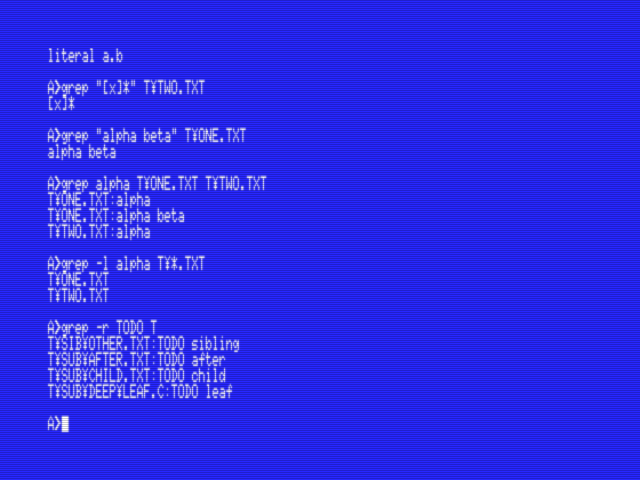
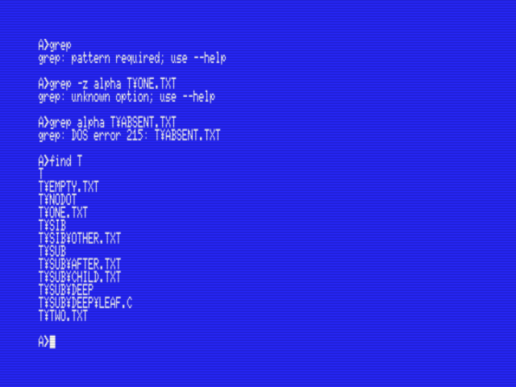
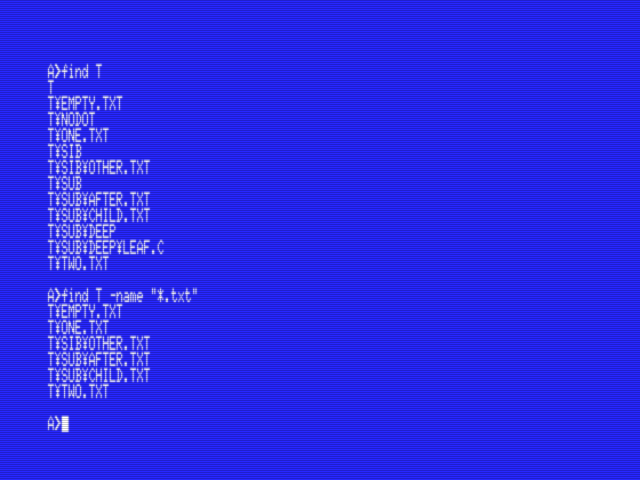

# 検証記録

2026-11-23、ローカルのopenMSX **21.0-unknown [Release]**、**Panasonic_FS-A1ST / MSX-DOS2**（COMMAND2.COM / MSXDOS2.SYS 2.20）で実行しました。SDCCは4.6.0 #16555。実機や他機種・Nextorでの互換性、安全性、実用性の保証ではありません。[お遊びツールとしての位置付けと免責](README.md#免責)を確認してください。

| 配布物 | サイズ | SHA-256 |
|---|---:|---|
| GREP.COM | 5378 | `cf24fbc7155709ada11c18c07f9655742f7c0f8056446a44cdf7b3503edd9023` |
| FIND.COM | 4201 | `1c8ac1d54f162cf0f87e7670a1c01db8930eb1817c636bae96754bb703576069` |

起動ディスクから実際のCOMを取り出し、配布バイナリと全バイト一致することを起動前に検査しています。BIOS/BDOSはモックではなく、実際のDOS2を使いました。

## 結果

**49ケース全通過**。終了コードだけでなく、標準出力の全バイト、標準エラーの内容、DOS2のリダイレクトで作成されたファイルの内容も比較しました。ディレクトリ列挙順に依存しないケースでは、行の集合を比較しています。

- GREP：通常一致、行番号、ASCII大小無視、否定、行数、ファイル名のみ、複数ファイル、DOSワイルドカード。
- 固定文字列：`.`や`[x]*`を正規表現にしないこと、空パターン、空ファイル、空白入りパターン、`-e`。
- 再帰：深い子ディレクトリ、親に戻った後の兄弟ファイル・兄弟ディレクトリを漏れなく処理。再帰中の件数・ファイル名非表示。
- 入力：LF/CRLF、末尾改行なし、512バイトの読み取り境界をまたぐ一致、64KBより大きいファイル、8192バイト行、8193バイト行の拒否、NULを含む行。
- 日本語：CP932のバッチからShift-JIS固定文字列を渡し、出力をバイト単位で照合。画面での漢字描画の検証ではありません。
- 標準入力へのリダイレクト、標準出力へのリダイレクト。
- FIND：全件、名前の`*`・`?`、ファイル／ディレクトリ、深さ0/1、AND条件、空の名前パターン、複数開始点、単一ファイル、`.`と省略時の開始点、`/`のパス。
- エラー：引数不足、未対応オプション、存在しないファイル／ディレクトリ、不正な深さ・種類指定、非再帰でのディレクトリ指定。途中エラーでも後続のファイルを検索し、最終終了コード2を保つこと。







## 保存済み証跡の確認

```sh
python tests/check.py
```

[期待結果](validation/expected.json)、[取得したバイト列・終了コード・バイナリ識別](validation/results.json)、[実行ログ](validation/results.log)を同梱しています。この確認はエミュレーターを再起動しません。

## エミュレーターで再実行する場合

自分で利用権限を確保したMSX-DOS2起動ディスクとFS-A1STのROMが別途必要です。配布物にこれらは含めていません。

```sh
python tests/prepare.py --work-dir /path/to/new-test-work --boot-disk /path/to/own-dos2-boot.dsk
```

新しい`run`ディレクトリに起動ディスクのコピー、合成テキスト、期待結果、`run.tcl`を生成します。既存の`run`ディレクトリがある場合は拒否します。コピー元の起動ディスクには古いGREP.COM/FIND.COMを入れないでください。

Windowsでの実行例（自身のパスに置き換え）：

```powershell
$env:OPENMSX_USER_DATA = 'C:\path\to\isolated-openmsx-user-data'
$searchRun = 'C:/path/to/new-test-work/run'
$p = Start-Process 'C:\Program Files\openMSX\openmsx.exe' -ArgumentList @('-machine','Panasonic_FS-A1ST','-diska',"$searchRun/boot.dsk",'-script',"$searchRun/run.tcl") -WindowStyle Hidden -PassThru
$p.WaitForExit()
python tests/check.py C:/path/to/new-test-work/run
```

専用ユーザーデータディレクトリに必要なROMを用意し、普段の環境とは分けてください。TclスクリプトはテストコピーへCOMとテキストを取り込み、DOS2のプロンプトでコマンドを実行します。DOSの出力・終了時点を観測しますが、CPUレジスターや検索結果は書き換えません。観測時には実行コードのシグネチャも照合し、同じアドレスにあるBIOS等の処理を誤って採取しないようにしています。

実行スクリプトの待ち時間は検証機向けです。遅いホスト等では起動待ち・タイムアウトを調整する必要があります。隠し・システム属性の全組合せ、実媒体の読み取り不良、すべてのパス長や階層限界、全ドライバーを網羅した試験ではありません。
